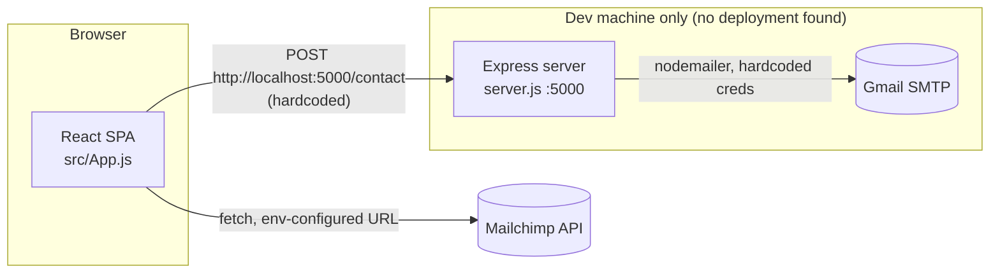

# Architecture

## Overview

This repository holds two independent pieces that happen to share one `package.json` and one git history:



- The **React SPA** is the whole product: a single scrolling page, client-rendered, no server-side rendering, no API of its own beyond the contact form.
- The **Express server** (`server.js`) is a separate, one-file mail relay. It is not started by any script in `package.json`, not containerized, not deployed anywhere as far as this repo shows — it only runs if someone manually executes `node server.js` next to a reachable SMTP account.

## Frontend component tree

```
App
├── NavBar            (own BrowserRouter instance, used only for HashLink anchors)
├── Banner
├── Skills
├── Projects
│   └── ProjectCard (repeated)
├── Contact           (posts to hardcoded localhost:5000/contact)
└── Footer
    └── MailchimpForm
        └── Newsletter
```

There is no React Router route table anywhere (`<Routes>`/`<Route>` do not appear in the codebase). `react-router-dom` is present solely so `NavBar` can use `HashLink` for smooth in-page scrolling, and `NavBar` instantiates its own `<BrowserRouter>` rather than sharing one from `App`.

## Data flow

- **Contact form:** `Contact.js` collects name/email/phone/message into local component state, then `fetch`-POSTs to `http://localhost:5000/contact`. `server.js` receives it, builds an HTML email with `nodemailer`, and sends it through a Gmail account whose credentials are hardcoded in the file (see `docs/SECURITY_REVIEW` findings referenced from `TECHNICAL_DEBT.md` — P0).
- **Newsletter signup:** `MailchimpForm.js` reads `REACT_APP_MAILCHIMP_URL` / `REACT_APP_MAILCHIMP_U` / `REACT_APP_MAILCHIMP_ID` from the environment (the one part of this repo that externalizes configuration correctly) and posts through `react-mailchimp-subscribe` directly to Mailchimp's API from the browser.
- **Everything else** (Banner, Skills, Projects) is static presentational content — no network calls, no state beyond local UI toggles.

## Persistence

None. No database, no ORM, no migrations, no server-side session state. The only "state" that outlives a page load is whatever Mailchimp stores on its side after a newsletter signup.

## Deployment topology

Not defined in this repo. No Dockerfile, no CI/CD workflow, no hosting config (no `vercel.json`, `netlify.toml`, `Procfile`, etc.). The `README.md` is the default Create React App template and documents only `npm start`/`build`/`test`/`eject` — nothing about `server.js` or how the two pieces are meant to run together in production.
